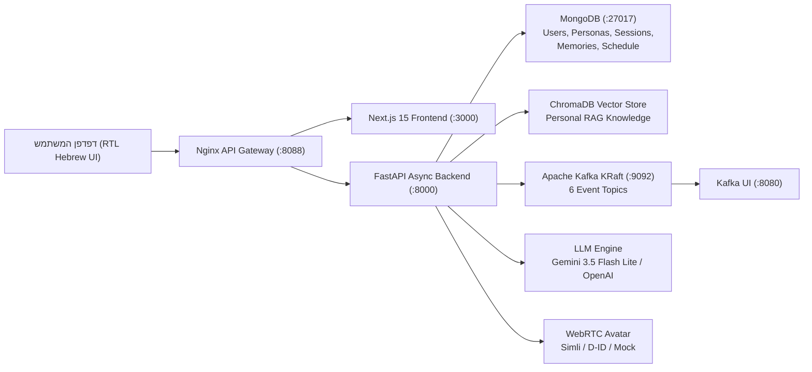

# AuraMeet AI — Autonomous Meeting Bot

> **פרויקט 2 מתוך מסלול Back End AI: Hi-Tech Gateway**  
> בוט פגישות אישי ואוטונומי המייצג את המשתמש בפגישות וידאו חיות, משלב **FastAPI Async**, **Nginx API Gateway**, **Apache Kafka + Kafka UI**, **Multi-LLM (`gemini-3.5-flash-lite` / OpenAI / Demo)**, **ChromaDB RAG**, **זיכרון ארוך-טווח**, **Guardrails**, **Human-in-the-Loop (HITL)**, **אבטחת JWT** ו-**Real-Time WebRTC Avatar Streaming (Simli / D-ID)**.

---

## ארכיטקטורת המערכת



---

## יכולות מרכזיות

### 1. אבטחת צד שרת וניהול משתמשים (`JWT` + העלאת אווטאר מהמחשב)
- **מסכי כניסה ייעודיים**: פתיחת האפליקציה מנתבת אוטומטית למסך `/login` (עם קישור ל-`/register`), ללא כפתור התחברות בסרגל הצדדי.
- **העלאת תמונת אווטאר מהמחשב**: בחירת קובץ (`JPG` / `PNG` / `WEBP`) בהרשמה עם אייקון אווטאר ברירת מחדל ותצוגה מקדימה מיידית (`POST /api/v1/auth/avatar/upload`), והורשה אוטומטית ביצירת פרסונה חדשה + אפשרות להחליף תמונה ישירות מכרטיס **פרסונה פעילה** (`POST /api/v1/personas/{id}/avatar`).
- **אבטחת JWT מלאה**: הצפנת סיסמאות `PBKDF2-HMAC-SHA256`, טוקן `JWT HS256` (`POST /api/v1/auth/register`, `POST /api/v1/auth/login`, `GET /api/v1/auth/me`, `PATCH /api/v1/auth/me`) וכפתור הצגת/הסתרת סיסמה (`Eye / EyeOff`).

### 2. סוכן AI אוטונומי בחדר פגישה חי (`WebSocket` + `WebRTC`)
- **מנוע `Multi-LLM` נעול ל-`gemini-3.5-flash-lite`** (עם ניסיונות חוזרים אוטומטיים על `503`/`429`), תמיכה גמישה ב-`OpenAI (GPT + Whisper)` ומצב `Demo`, שליטה ב-`Temperature`, `MaxTokens`, `Top P` ומדידת טוקנים.
- **בסיס ידע אישי (`RAG`)**: העלאת קובצי `PDF / TXT / MD` לכל פרסונה ואינדוקס וקטורי ב-`ChromaDB`.
- **זיכרון קצר וארוך-טווח**: שמירת עובדות מפתח (`key_facts`) ב-`MongoDB` בסיום פגישה ושליפתן אוטומטית לפגישות הבאות (`GET /api/v1/personas/{id}/memories`).
- **`Guardrails`**: חסימת `Prompt Injection`, הסתרת מפתחות/מידע רגיש וניקוי `Markdown` לפני דיבור האווטאר.
- **`Human-In-The-Loop (HITL)` + פתיחה אוטונומית**: כפתור פתיחת פגישה אוטונומית ומצב אישור/עריכה ידנית לפני שהאווטאר מדבר, לצד מדדי זמן אמת (`STT / RAG / LLM / TTS ms` וטוקנים).
- **לוח שנה, תזמון ותבניות סיכום**: ניהול פגישות מתוזמנות, הפקת סיכומי פגישה ו-`Action Items` לפי תבניות מובנות ומותאמות אישית.

### 3. ארכיטקטורה מונחית-אירועים (`Apache Kafka` + `Kafka UI`)
המערכת מפרסמת וצורכת אירועים בזמן אמת ב-6 טופיקים מסודרים (נוצרים אוטומטית בהפעלה):

| טופיק (`Topic`) | תיאור האירועים |
| :--- | :--- |
| `meeting.events` | פתיחת/סיום פגישות, יצירת ומחיקת תבניות, עליית שירות |
| `meeting.schedule` | תזמון פגישות חדשות בלוח השנה וביטול פגישות מתוזמנות |
| `meeting.transcripts` | חילופי דברים בזמן אמת, פתיחה אוטונומית ומדדי ביצועים |
| `meeting.personas` | יצירה/מחיקה של פרסונות, עדכון תמונת אווטאר, אינדוקס RAG וזיכרון ארוך-טווח |
| `meeting.auth` | הרשמת משתמשים, התחברות, עדכון פרופיל והעלאת אווטאר |
| `meeting.alerts` | התראות לוח שנה, הפעלת `Guardrails`, אישורי `HITL`, ניסיונות התחברות כושלים ושגיאות WebSocket |

### 4. `Nginx API Gateway` וניהול שגיאות מרכזי
- **נקודת כניסה אחת (`http://localhost:8088`)**: ניתוב מאוחד ל-`Frontend`, `REST API`, `WebSockets`, קבצים מועלים (`/uploads/`) ו-`Swagger`, כולל `Rate Limiting` וכותרות אבטחה.
- **`Centralized Error Manager`**: החזרת שגיאות מובנות ואחידות (`code`, `message`, `details`, `request_id`, `timestamp`).

---

## הרצה מהירה עם Docker Compose

### 1. הגדרת משתני סביבה (ללא שמירת מפתחות ב-Git)
העתק את קובץ הדוגמה והזן את המפתחות שלך מקומית (הקובץ `backend/.env` חסום ב-`.gitignore` ולא עולה ל-GitHub):

```bash
cp backend/.env.example backend/.env
```

המשתנים העיקריים ב-`backend/.env`:
- `GEMINI_API_KEY` — מפתח Google Gemini API (מודל ברירת מחדל: `gemini-3.5-flash-lite`)
- `SIMLI_API_KEY` / `SIMLI_FACE_ID` — אווטאר WebRTC חי (או `DID_API_KEY` / `DID_MOCK_MODE=true`)
- `JWT_SECRET_KEY` — מפתח סודי לחתימת טוקני JWT

### 2. הפעלת כל 6 הקונטיינרים
```bash
docker compose up -d --build
```

### כתובות השירותים הפעילים

| שירות | כתובת | תפקיד |
| :--- | :--- | :--- |
| **API Gateway (כניסה ראשית)** | `http://localhost:8088` | נקודת הכניסה הראשית לאפליקציה ול-API |
| **Swagger API Docs** | `http://localhost:8088/docs` | תיעוד OpenAPI אינטראקטיבי |
| **Kafka UI** | `http://localhost:8080` | ניטור חי של הטופיקים, ההודעות וה-Consumers |
| **Backend Direct** | `http://localhost:8000/health` | בדיקת תקינות השרת וסטטוס Kafka/LLM |
| **Frontend Direct** | `http://localhost:3000` | ממשק Next.js ישיר |

---

## בדיקות ו-CI/CD

### הרצת בדיקות Backend (`pytest`)
```bash
docker exec meeting-bot-backend pytest -v
```

### צינור GitHub Actions
הפרויקט כולל צינור CI אוטומטי בקובץ `.github/workflows/ci.yml` המריץ בכל `push` / `pull_request`:
1. התקנת תלויות והרצת חבילת `pytest` מלאה (במצב `demo` ו-`mock`).
2. בניית `Next.js` ובדיקת TypeScript (`npm run build`).

---

## מבנה הפרויקט

```text
autonomous-meeting-bot/
├── .github/workflows/ci.yml     # GitHub Actions CI/CD
├── gateway/nginx.conf           # Nginx API Gateway (Rate Limit, WS, Proxy)
├── docker-compose.yml           # MongoDB, Kafka, Kafka UI, Backend, Frontend, Gateway
├── backend/
│   ├── app/
│   │   ├── api/                 # routes_auth, routes_personas, routes_sessions, routes_features, ws_meeting
│   │   ├── core/                # config, database, security (JWT), errors (Centralized Error Manager)
│   │   ├── models/              # Pydantic v2 schemas
│   │   └── services/            # llm_service, rag_service, memory_service, guardrails_service, kafka_service, simli_service, did_service
│   ├── tests/test_api.py        # Unit & Integration Tests
│   └── .env.example             # Safe template without secrets
└── frontend/
    └── src/
        ├── app/                 # / (Auth-guarded Dashboard), /login, /register
        ├── components/          # AvatarStage, PersonaManager, CalendarScheduler, DashboardPanel, TranscriptPanel, ...
        ├── hooks/               # useMeetingSocket, useWebRTC, useAudioRecorder
        └── lib/api.ts           # Typed API Client with JWT Bearer support
```
