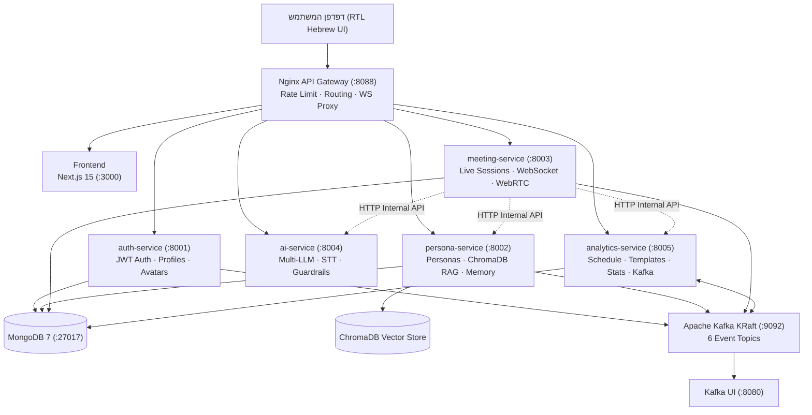

<div dir="rtl" align="right">

# AuraMeet AI — Autonomous Meeting Bot (Microservices Architecture)

[](https://github.com/IDAN2468D/autonomous-meeting-bot/actions/workflows/ci.yml)


> **פרויקט 2 מתוך מסלול Back End AI: Hi-Tech Gateway**  
> מערכת **בוט פגישות אישי ואוטונומי** בארכיטקטורת **Microservices** מלאה — המייצגת את המשתמש בפגישות וידאו חיות עם אווטאר בזמן אמת (`WebRTC`), מנוע `Multi-LLM` (`Gemini 3.5 Flash Lite` / `OpenAI` / `Demo`), בסיס ידע אישי (`ChromaDB RAG`), זיכרון ארוך-טווח, `Guardrails`, בקרת `Human-in-the-Loop (HITL)`, הזרמת אירועים ב-`Apache Kafka` ו-`Nginx API Gateway`.

---

## ארכיטקטורת המיקרוסרוויסים



---

## פירוט השירותים (`Services Catalog`)

המערכת מופרדת ל-**5 מיקרוסרוויסים עצמאיים** + חבילת תשתית משותפת (`shared/aurameet_shared`) + `Nginx API Gateway` + `Frontend`:

| שירות | פורט | נתיבים ב-Gateway | אחריות מרכזית |
| :--- | :---: | :--- | :--- |
| **`auth-service`** | `8001` | `/api/v1/auth/*`, `/uploads/*` | הרשמה והתחברות עם `JWT HS256`, הצפנת `PBKDF2-HMAC-SHA256`, ניהול פרופיל והעלאת תמונות אווטאר |
| **`persona-service`** | `8002` | `/api/v1/personas/*` | ניהול פרסונות, אינדוקס מסמכי `PDF / TXT / MD` ב-`ChromaDB (RAG)` וזיכרון ארוך-טווח ב-`MongoDB` |
| **`meeting-service`** | `8003` | `/api/v1/sessions/*`, `/ws/meeting/*` | ניהול חדרי פגישה חיים, `WebSocket` בזמן אמת, `HITL`, וזרם אווטאר `WebRTC` (`Simli` / `D-ID` / `Mock`) |
| **`ai-service`** | `8004` | `/api/v1/ai/*` | מנוע `Multi-LLM` (`Gemini 3.5 Flash Lite` / `OpenAI` / `Demo`), תמלול אודיו (`STT`), סיכומי פגישות ו-`Guardrails` |
| **`analytics-service`** | `8005` | `/api/v1/templates`, `/api/v1/schedule`, `/api/v1/stats`, `/api/v1/kafka/*` | תבניות סיכום, לוח שנה ותזמון פגישות, סטטיסטיקות דשבורד וצריכת/ניטור אירועי `Kafka` |
| **`gateway`** | `8088` | `/` (כניסה ראשית) | `Nginx API Gateway` — ניתוב אחיד לכל השירותים, `Rate Limiting`, תמיכת `WebSocket` וכותרות אבטחה |
| **`frontend`** | `3000` | `/` | ממשק `Next.js 15` מלא בעברית (`RTL`), מסכי `/login` ו-`/register`, חדר פגישה חי ולוח בקרה |

---

## ארכיטקטורה מונחית-אירועים (`Apache Kafka`)

כל מיקרוסרוויס מפרסם אירועי דומיין ל-`Kafka`, בעוד `analytics-service` משמש כ-`Consumer` מרכזי לניטור ובקרה בזמן אמת (ניתן לצפות בהכל ב-`Kafka UI` בפורט `8080`):

| טופיק (`Topic`) | מפרסמים (`Producers`) | תיאור האירועים |
| :--- | :--- | :--- |
| `meeting.auth` | `auth-service` | הרשמה, התחברות, עדכון פרופיל והעלאת תמונת אווטאר |
| `meeting.personas` | `persona-service` | יצירה/מחיקה של פרסונות, אינדוקס `RAG` ושמירת זיכרון ארוך-טווח |
| `meeting.events` | `meeting-service`, `analytics-service` | פתיחת/סיום פגישות, יצירת/מחיקת תבניות סיכום ועליית שירותים |
| `meeting.transcripts` | `meeting-service` | חילופי דברים בזמן אמת, פתיחה אוטונומית ומדדי ביצועים (`STT/RAG/LLM/TTS`) |
| `meeting.schedule` | `analytics-service` | תזמון פגישות חדשות וביטול פגישות בלוח השנה |
| `meeting.alerts` | `auth-service`, `meeting-service`, `analytics-service` | חסימות `Guardrails`, בקשות `HITL`, התחברות כושלת והתראות לוח שנה |

---

## הרצה מהירה עם Docker Compose

### 1. הגדרת משתני סביבה (ללא שמירת סודות ב-Git)
העתק את קובץ התבנית והזן את המפתחות שלך מקומית (`.env` חסום ב-`.gitignore`):

```bash
cp .env.example .env
```

המשתנים העיקריים ב-`.env`:
- `GEMINI_API_KEY` — מפתח Google Gemini API (מודל ברירת מחדל: `gemini-3.5-flash-lite`)
- `SIMLI_API_KEY` / `SIMLI_FACE_ID` — אווטאר `WebRTC` חי (או `DID_API_KEY` / `DID_MOCK_MODE=true`)
- `JWT_SECRET_KEY` — מפתח סודי לחתימת טוקני `JWT`

### 2. הפעלת כל 10 הקונטיינרים
```bash
docker compose up -d --build
```

### כתובות השירותים הפעילים

| שירות | כתובת | תיאור |
| :--- | :--- | :--- |
| **API Gateway (כניסה ראשית)** | `http://localhost:8088` | נקודת הכניסה הראשית לאפליקציה ולכל ה-APIs |
| **Kafka UI** | `http://localhost:8080` | ניטור חי של הטופיקים, ההודעות וה-Consumers |
| **Auth Service Docs** | `http://localhost:8001/docs` | תיעוד Swagger של `auth-service` |
| **Persona Service Docs** | `http://localhost:8002/docs` | תיעוד Swagger של `persona-service` |
| **Meeting Service Docs** | `http://localhost:8003/docs` | תיעוד Swagger של `meeting-service` |
| **AI Service Docs** | `http://localhost:8004/docs` | תיעוד Swagger של `ai-service` |
| **Analytics Service Docs** | `http://localhost:8005/docs` | תיעוד Swagger של `analytics-service` |

---

## בדיקות אוטומטיות ו-CI/CD

לכל מיקרוסרוויס יש חבילת בדיקות עצמאית (`pytest`) שניתן להריץ בנפרד או דרך `GitHub Actions`:

```bash
# הרצת בדיקות לכל שירות בנפרד
cd services/auth-service && pytest -v
cd services/persona-service && pytest -v
cd services/meeting-service && pytest -v
cd services/ai-service && pytest -v
cd services/analytics-service && pytest -v
```

### צינור `GitHub Actions` (`.github/workflows/ci.yml`)
בכל `push` ו-`pull_request`, ה-CI מריץ במקביל:
1. **מטריצת בדיקות (`microservice-tests`)** — הרצת `pytest -v` לכל 5 המיקרוסרוויסים (במצב `demo` + `mock`).
2. **בניית Frontend (`frontend-build`)** — בדיקת `TypeScript` ובניית `Next.js` (`npm run build`).

---

## מבנה הפרויקט

```text
autonomous-meeting-bot/
├── .github/workflows/ci.yml            # GitHub Actions CI/CD (Matrix per Microservice + Frontend)
├── .env.example                        # תבנית משתני סביבה נקייה ללא סודות
├── docker-compose.yml                  # 10 קונטיינרים: 5 Microservices + Gateway + Frontend + Mongo + Kafka + Kafka UI
├── gateway/
│   └── nginx.conf                      # Nginx API Gateway (Path-based Microservice Routing, WS, Rate Limit)
├── shared/
│   └── aurameet_shared/                # ספריית תשתית משותפת (config, database, security, errors, kafka_client)
├── services/
│   ├── auth-service/                   # (:8001) JWT Auth, Profiles & Avatar Uploads + pytest
│   ├── persona-service/                # (:8002) Personas, ChromaDB RAG & Long-Term Memory + pytest
│   ├── meeting-service/                # (:8003) Live Sessions, WebSocket, HITL & WebRTC Avatars + pytest
│   ├── ai-service/                     # (:8004) Multi-LLM (Gemini/OpenAI/Demo), STT, Summary & Guardrails + pytest
│   └── analytics-service/              # (:8005) Calendar Schedule, Summary Templates, Stats & Kafka Monitor + pytest
├── frontend/                           # (:3000) Next.js 15 RTL Hebrew UI
└── docs/                               # מסמכי אפיון ותכנון (PRD, SPEC, PLAN, STATE)
```

</div>
